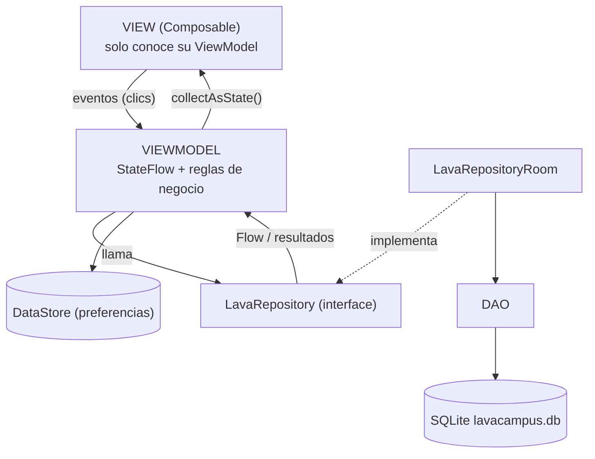

# LavaCampus

App Android de la lavandería de un campus universitario, hecha con **Kotlin + Jetpack Compose + Material 3**, patrón **MVVM + Repository** y base de datos local con **Room**. Dos perfiles conviven en el mismo celular y comparten la misma base de datos:

- **Estudiante:** arma un pedido eligiendo servicios y cantidades (kilos o prendas), ve el total y la fecha estimada de entrega, sigue el estado de su ropa y la recoge en un casillero.
- **Administrador:** recibe los pedidos, los avanza de estado (Recibido, En proceso, Listo, Entregado), asigna el casillero, cobra, administra las tarifas y consulta a sus clientes.

Cuando el administrador marca un pedido como Listo, el estudiante lo ve al instante con su casillero, porque ambas pantallas observan los mismos `Flow` de Room.

> Curso: Programación en Móviles, Tecsup. Laboratorio 08 (MVVM + Room). Todos los datos son ficticios (Ley 29733).

## Tecnologías

| | |
|---|---|
| Lenguaje / UI | Kotlin, Jetpack Compose, Material 3 (sin XML) |
| Arquitectura | MVVM + Repository (interface) |
| Datos | Room 2.8.4 (KSP), DataStore Preferences |
| Navegación | Navigation Compose |
| Fechas | `java.time` (`minSdk` 26) |

## Árbol de paquetes

```
com.reyes.lavacampus
├── MainActivity.kt
├── LavaApp.kt                      crea la base, el repository y las preferencias
├── data
│   ├── local
│   │   ├── entity    Servicio, Usuario, Pedido, DetallePedido
│   │   ├── dao       ServicioDao, UsuarioDao, PedidoDao, DetalleDao
│   │   ├── relation  DetalleConServicio, PedidoConDetalle
│   │   ├── LavaDatabase.kt
│   │   └── DatosIniciales.kt
│   ├── repository    LavaRepository (interface), LavaRepositoryRoom
│   └── prefs         PreferenciasStore (DataStore)
├── model             Rol, EstadoPedido, Unidad, LineaPedido, IngresoServicio,
│                     ClienteResumen, Casilleros
├── viewmodel         Sesion, Inicio, NuevoPedido, MisPedidos, DetallePedido, Perfil,
│                     Tarifas, Panel, Bandeja, GestionPedido, Servicios, Clientes
│                     + LavaViewModelFactory
└── ui
    ├── theme         Color, Type, Theme (LavaTheme según el rol)
    ├── components    AppTopBar, LavaButton, LavaTextField, EstadoPedidoChip, PedidoCard,
    │                 StepperEstado, IconoServicio, SelectorCantidad, FilaSwitch, ...
    │   └── graficos  GraficoDona, GraficoBarras
    ├── navigation    Rutas, NavLava, BarraInferior
    ├── estudiante    Splash, Login, Inicio, NuevoPedido, DetallePedido, MisPedidos,
    │                 Tarifas, Perfil
    └── administrador Panel, Bandeja, GestionPedido, Servicios, FormularioServicio,
                      Clientes, Ajustes
```

## Arquitectura MVVM + Repository



| Capa | Conoce a | No debe |
|---|---|---|
| View (`ui/`) | Solo a su ViewModel | Usar DAO, Repository ni reglas de negocio |
| ViewModel | Solo al Repository (interface) | Conocer Composables ni el DAO |
| Repository | Los DAOs (en la implementación) | Conocer pantallas ni ViewModels |
| DAO / Room | SQL y entidades | Conocer ViewModels |

Regla usada en todo el proyecto: una **lectura** que debe actualizar la pantalla es un `Flow` (sin `suspend`); una **escritura** o acción única es `suspend`.

## Base de datos

4 tablas: `usuarios`, `servicios`, `pedidos` y `detalles_pedido`. Un pedido tiene muchos detalles (relación uno a muchos) y cada detalle apunta a un servicio. `crearPedido` guarda el pedido y todas sus líneas dentro de **una sola transacción** (`db.withTransaction`).

Datos de prueba (se cargan solo la primera vez):

| Perfil | Correo | Clave |
|---|---|---|
| Estudiante | `ana@correo.test` | `1234` |
| Estudiante | `luis@correo.test` | `1234` |
| Estudiante | `marta@correo.test` | `1234` |
| Administrador | `admin@lavacampus.test` | `admin` |

## Reglas de negocio (viven en los ViewModels)

- Máximo **3 pedidos activos** por estudiante (Recibido, En proceso o Listo).
- Kilos de 1.0 a 10.0 en pasos de 0.5; prendas y unidades enteras de 1 a 30. Solo servicios activos.
- Total = suma de `cantidad × precio`; el precio se congela en el detalle.
- Fecha de entrega = hoy + el mayor tiempo de entrega elegido; si cae **domingo**, pasa al lunes.
- El estudiante solo cancela pedidos **Recibido**; el administrador, Recibido o En proceso.
- Los estados solo avanzan un paso: Recibido → En proceso → Listo → Entregado. Para **Listo** hace falta un casillero libre (C-01 a C-30) y para **Entregado** el pedido debe estar cobrado.
- Un servicio que ya está en algún pedido no se elimina, solo se desactiva.
- Si el administrador apaga "Recibir pedidos", el estudiante no puede crear uno.

## Capturas

### Estudiante

| Inicio | Nuevo pedido | Detalle del pedido |
|---|---|---|
|  |  |  |

### Administrador

| Panel | Bandeja | Gestión del pedido |
|---|---|---|
|  |  |  |

## Para pensar

**¿Por qué un pedido tiene sus detalles en otra tabla?**
Porque un pedido puede incluir varios servicios (por ejemplo lavado y planchado). Guardar cada línea como una fila de `detalles_pedido` evita columnas repetidas y permite consultar el ingreso por servicio con un `GROUP BY`. Es la relación uno a muchos más común del mundo real.

**¿Por qué se guardan `precioUnitario` y `subtotal` en el detalle?**
Porque son una "foto" del momento. Si mañana la lavandería sube el precio del kilo, los pedidos antiguos conservan lo que costaron y los ingresos del panel no se alteran.

**¿Por qué el Repository es una interface?**
Para poder cambiar de dónde vienen los datos (más adelante un servicio web o la nube) sin tocar los ViewModels ni las pantallas: solo cambia la clase que la implementa.

**¿Por qué las reglas de negocio están en los ViewModels y no en los Composables ni en los DAOs?**
Porque así las pantallas solo muestran el estado y avisan los eventos, y los DAOs solo ejecutan SQL. Las reglas quedan en un solo lugar y se pueden probar sin dibujar ninguna pantalla.

## Cómo ejecutarlo

1. Abrir la carpeta `Semana08` en Android Studio y sincronizar Gradle.
2. Ejecutar en un emulador o celular con Android 8.0 (API 26) o superior.
3. Si cambias una entidad después de haber ejecutado la app, sube la `version` de `LavaDatabase` o desinstala la app del dispositivo; si no, Room falla porque el esquema no coincide.
