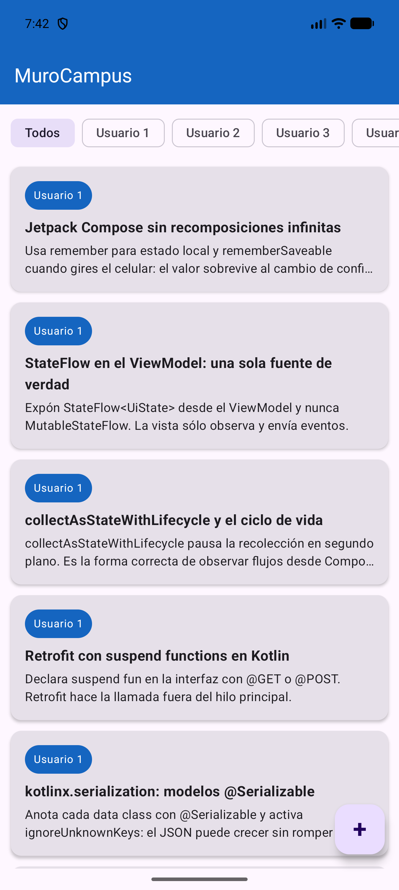
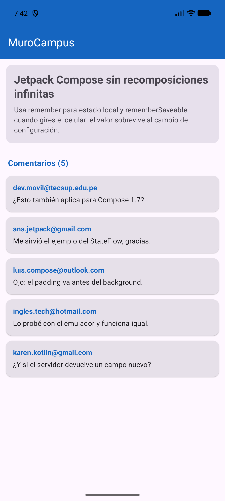
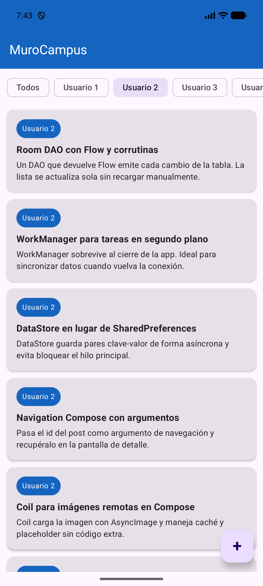
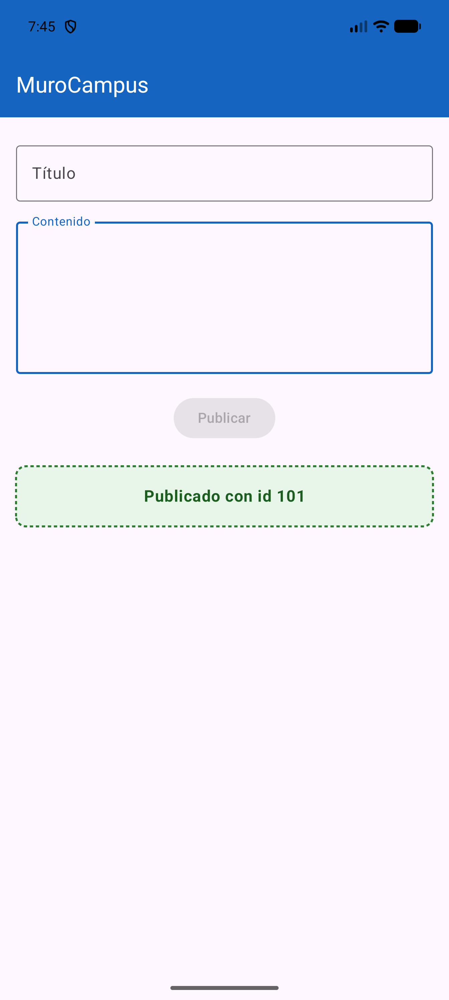
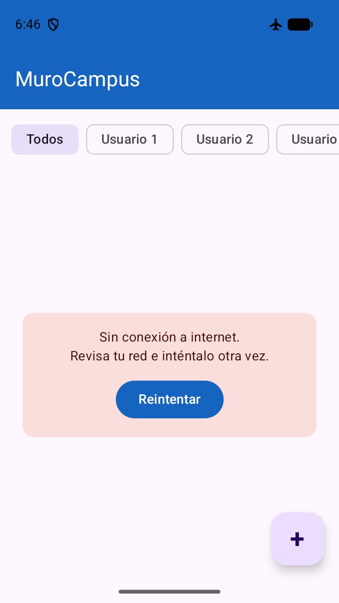

# MuroCampus

Laboratorio N°09 — Programación en Móviles (Tecsup). Aplicación Android en Kotlin + Jetpack Compose que consume la API REST pública [JSONPlaceholder](https://jsonplaceholder.typicode.com/): lista publicaciones, muestra el detalle con sus comentarios, filtra por usuario y crea una publicación nueva. Implementada con arquitectura limpia **MVVM + Repository** y sin IA (Fase 1).

## Descripción

- **Lista:** 100 publicaciones con etiqueta `Usuario N`, título en negrita y resumen a 2 líneas.
- **Detalle:** título y cuerpo completos + `Comentarios (N)` con correo en azul y texto de cada comentario.
- **Filtro:** `LazyRow` de chips `Todos`, `Usuario 1` … `Usuario 10` (`GET /posts?userId=N`).
- **Crear:** formulario con validación y respuesta `Publicado con id 101` (`POST /posts` con `@Body`).
- **Errores:** estados `Cargando`, `Éxito` y `Error` con mensaje y botón `Reintentar`.
- **Tecnologías:** Kotlin 2.2.10, Jetpack Compose, Retrofit 2.11.0, OkHttp 4.12.0, kotlinx.serialization 1.7.3, Corrutinas, StateFlow y `collectAsStateWithLifecycle()`.

> **Textos de la app.** JSONPlaceholder devuelve títulos y cuerpos en latín de relleno (*lorem ipsum*). Para que el muro tenga sentido, `ContenidoDemo` (en la capa `data/`) reemplaza solo el texto por temas de programación móvil (Compose, Retrofit, StateFlow, corrutinas...). Los `id`, `userId`, `postId`, la cantidad de publicaciones y comentarios, y las llamadas HTTP siguen siendo los reales del servicio. La publicación creada con POST se muestra tal como la devuelve el servidor.

## Árbol de paquetes

```
com.reyes.murocampus/
├── MainActivity.kt                    [E] navegación por estado + creación del ViewModel
├── model/
│   └── Modelos.kt                     Usuario, Post, Comentario, NuevoPost (@Serializable)
├── data/
│   ├── remote/
│   │   ├── PostApi.kt                 interface Retrofit: GET/POST, @Path, @Query, @Body
│   │   └── RetrofitClient.kt          Json, OkHttp + HttpLoggingInterceptor, api by lazy
│   ├── PostRepository.kt              interface + PostRepositoryRemote (Result<T>)
│   └── ContenidoDemo.kt               textos de programación móvil en español
├── viewmodel/
│   ├── UiState.kt                     sealed interface + mensajeDe(Throwable)
│   ├── PostsViewModel.kt              lista, filtro, detalle y creación (StateFlow)
│   └── PostsViewModelFactory.kt       fábrica con PostRepository
└── ui/
    ├── Componentes.kt                 MuroTopBar, TarjetaPost, Cargando, ErrorConReintento
    ├── PantallaLista.kt               LazyRow de chips + LazyColumn + FAB
    ├── PantallaDetalle.kt             publicación completa + comentarios + BackHandler
    ├── PantallaCrear.kt               formulario, validación y confirmación
    └── theme/                         Color.kt, Theme.kt, Type.kt (tema azul)
```

## Diagrama MVVM + Repository

```
 View (ui/)  PantallaLista · PantallaDetalle · PantallaCrear
      │  eventos: cargar / filtrar / abrir / publicar / reintentar
      │  observa: collectAsStateWithLifecycle()
      ▼
 ViewModel (PostsViewModel)  ── StateFlow<UiState<T>> ──▶  Cargando / Exito / Error
      │  viewModelScope.launch
      ▼
 PostRepository (interface)  ◀── PostRepositoryRemote  (Result<T>, nunca lanza excepciones)
      │
      ▼
 PostApi (Retrofit) ── OkHttp + kotlinx.serialization ──▶ https://jsonplaceholder.typicode.com/
```

**Reglas de oro aplicadas:** la vista nunca llama a Retrofit; el ViewModel no conoce `Retrofit`, `PostApi`, `HttpException` ni `Context`; el Repository relanza `CancellationException` y devuelve `Result.failure(e)` para cualquier otra excepción.

## Capturas

Las capturas se toman del emulador y se guardan en `docs/capturas/`.

| Lista | Detalle | Filtro |
| --- | --- | --- |
|  |  |  |

| Crear | Error de conexión |
| --- | --- |
|  |  |

## Para pensar

1. **¿Qué diferencia hay entre GET y POST? ¿Por qué crear lleva `@Body` y porUsuario lleva `@Query`?**
   `GET` lee un recurso y no debería modificarlo; `POST` envía datos para crear uno nuevo. `crear()` necesita `@Body` porque el servidor requiere el JSON del nuevo post en el cuerpo de la petición (`userId`, `title`, `body`). `porUsuario()` no envía cuerpo: necesita identificar un recurso ya existente, y eso se hace con el parámetro de URL `@Query("userId")`, que produce `posts?userId=2`.

2. **¿Por qué la ruta es `"posts"` y no `"/posts"`?**
   Retrofit resuelve cada ruta relativa a partir del `baseUrl`, que termina en `/`. Escribir `"posts"` da `https://jsonplaceholder.typicode.com/posts`; escribir `"/posts"` reemplazaría el path base (y en Retrofit 2 las rutas absolutas no son válidas), por lo que la URL sería incorrecta.

3. **¿Por qué el Repository devuelve `Result` en vez de dejar que la excepción llegue al ViewModel?**
   Porque así la capa de datos encapsula los fallos de red, HTTP y serialización. El ViewModel sólo decide qué `UiState` publicar (`Error(mensajeDe(it))`) sin importar `IOException`, `HttpException` ni `SerializationException`. Además, se relanza `CancellationException` para no tragarse la cancelación de corrutinas. El ViewModel queda desacoplado de Retrofit y es fácil de testear con un repositorio falso.

4. **¿Qué pasa si olvidas el permiso INTERNET? ¿Y si olvidas `ignoreUnknownKeys` y el servidor agrega un campo nuevo?**
   Sin `<uses-permission android:name="android.permission.INTERNET" />` la app compila, pero el sistema deniega la conexión y la llamada falla con un error de red (`UnknownHostException`/`IOException`); se verá el estado `Sin conexión a internet...`. Sin `ignoreUnknownKeys = true`, kotlinx.serialization lanza `SerializationException` al encontrar un campo JSON que no existe en la `data class`, y la pantalla mostraría `Respuesta inesperada`.

5. **¿Por qué la pantalla de lista usa un `when` sobre `UiState` y no un `if` con tres variables?**
   Porque `UiState` es un `sealed interface`: los estados son mutuamente excluyentes y el compilador obliga a cubrirlos todos. Un `if` con tres variables booleanas permite combinaciones imposibles (por ejemplo `Cargando` y `Error` a la vez), genera estados incoherentes y es más difícil de mantener. El `when` hace que cada estado tenga un único renderizado.

6. **JSONPlaceholder no guarda los POST. ¿Cómo cambiaría tu app si usaras un servicio real?**
   El contrato de la UI y del ViewModel no cambiaría: seguirían existiendo `publicar()`, `creacion: StateFlow<UiState<Post>>` y el mensaje con el `id` devuelto. Sólo se sustituiría `RetrofitClient` con la URL real (y, si hace falta, autenticación mediante un `Interceptor`), y se ajustarían los modelos si el servidor usa otros nombres de campos. Opcionalmente, tras un POST exitoso se podría recargar la lista o insertar el post devuelto en el estado local para que aparezca; con JSONPlaceholder eso no se hace porque el servicio sólo simula la respuesta.

## Pruebas de la Fase 1 (Paso 10)

| Prueba | Cómo se provocó | Resultado obtenido | OK |
| --- | --- | --- | --- |
| Sin internet | Modo avión y abrir la app | `Sin conexión a internet.` y botón Reintentar | ✔ |
| Reintentar | Quitar modo avión y pulsar Reintentar | Carga la lista | ✔ |
| Recurso inexistente | Pedir `detalle(9999)` (temporal) | `Error del servidor (404)` | ✔ |
| JSON inesperado | Agregar a `Post` un campo que no llega (temporal) | `Respuesta inesperada` | ✔ |
| Cancelación | Abrir el detalle y volver rápido | Sin errores en Logcat | ✔ |
| Lista y detalle | Abrir varias publicaciones | Siempre 5 comentarios | ✔ |
| Filtro | Elegir cada usuario | Siempre 10 publicaciones (`posts?userId=N`) | ✔ |
| Crear | Enviar una publicación | `Publicado con id 101` (respuesta 201) | ✔ |
| Código | Revisar `viewmodel/` | Sin Retrofit, PostApi ni HttpException en el ViewModel | ✔ |

> Nota sobre la prueba 404: si se cambia la ruta a `@GET("posts/9999")` pero se deja el parámetro `@Path("id")`, Retrofit lanza `IllegalArgumentException` (la URL no contiene `{id}`) y se ve `Error desconocido`. Por eso la prueba se hace pidiendo el id 9999 y dejando la ruta `posts/{id}`.

## Commits de la Fase 1

1. `chore: importa proyecto base MuroCampus`
2. `chore(red): agrega permiso de internet y dependencias de Retrofit`
3. `feat(model): agrega Post, Comentario y NuevoPost`
4. `feat(api): define la interface PostApi con GET y POST`
5. `feat(red): crea RetrofitClient con OkHttp y conversor JSON`
6. `feat(data): agrega PostRepository que devuelve Result`
7. `feat(ui): lista de publicaciones con estados Cargando, Exito y Error`
8. `feat(detalle): muestra publicacion y comentarios con Path`
9. `feat(filtro): filtra publicaciones por usuario con Query`
10. `feat(crear): publica una nueva publicacion con POST y Body`
11. `docs: agrega README con estructura y capturas`
