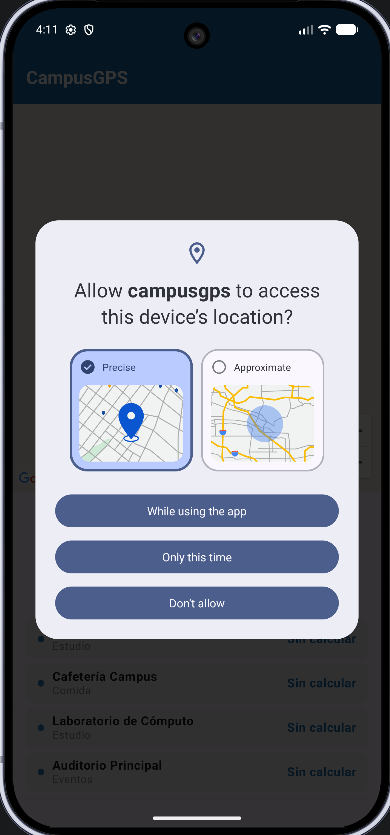
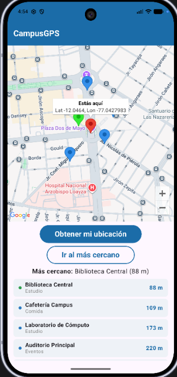
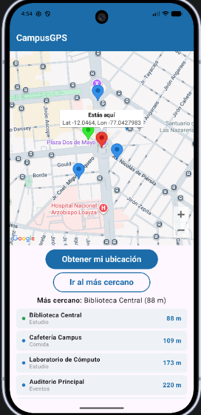
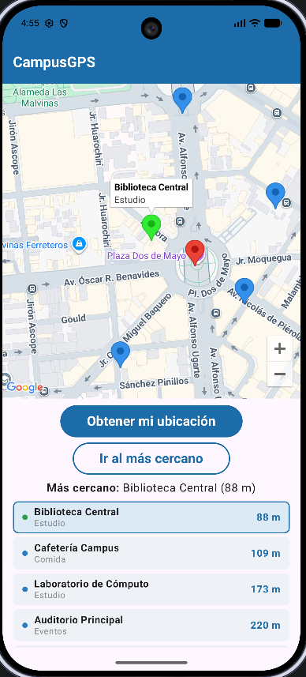
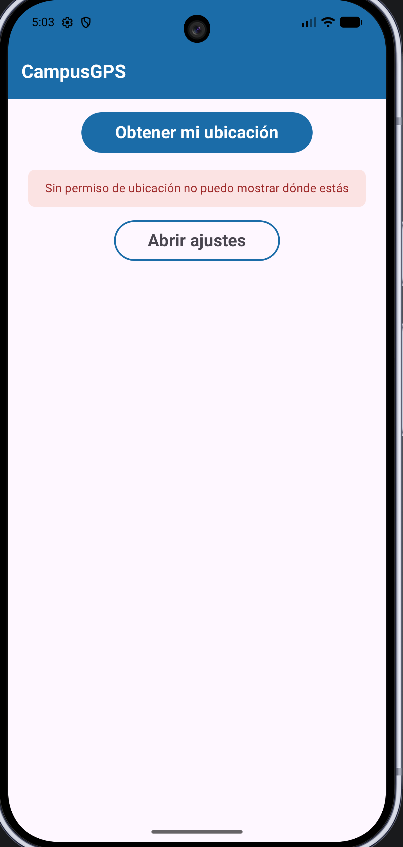
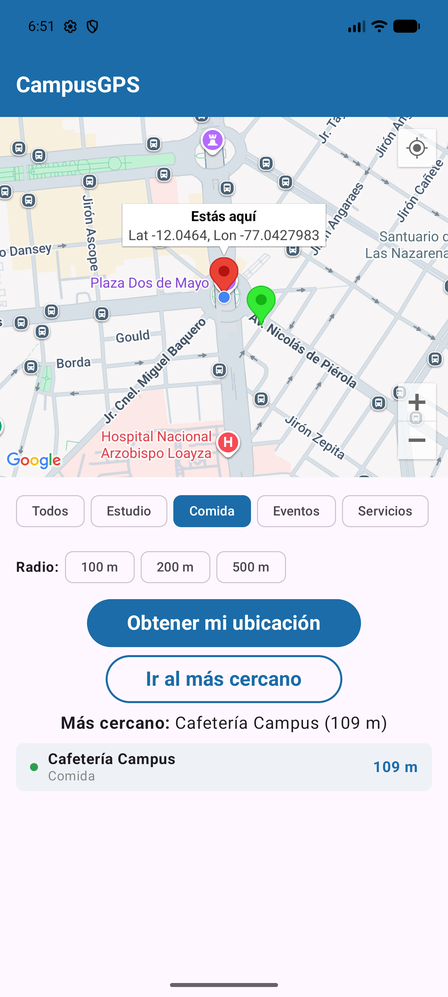
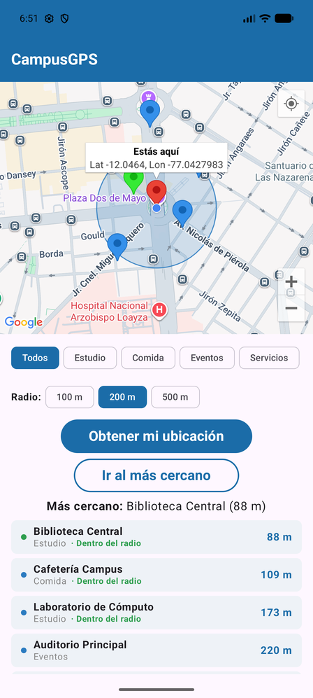
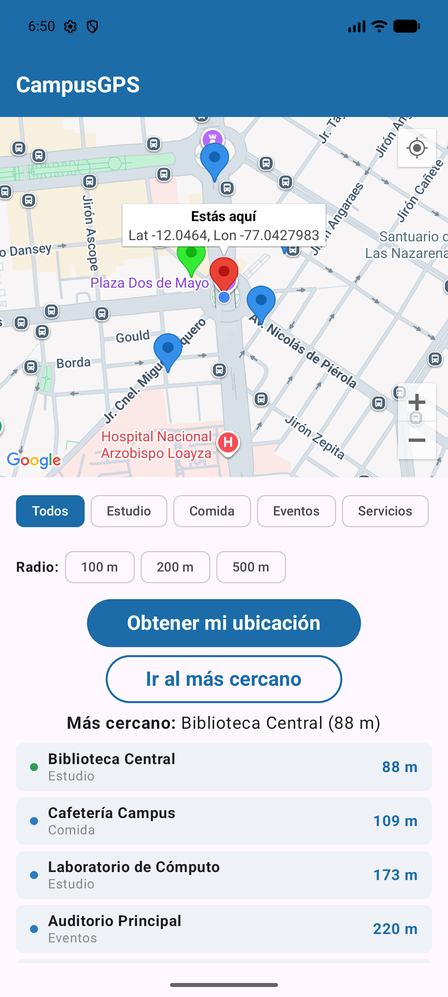

# CampusGPS

App Android que obtiene la ubicación del celular, la muestra en un mapa y te dice qué lugar del campus tienes más cerca. Muestra cinco puntos ficticios (biblioteca, cafetería, laboratorio, auditorio y estacionamiento) con su distancia en metros, ordenados del más cercano al más lejano.

- **Curso:** Programación en Móviles (Tecsup), Laboratorio 13: Localización Geográfica
- **Alumno:** Reyes Saravia Jordan Arturo
- **Tecnología:** Kotlin + Jetpack Compose + Material 3, Google Play Services Location y Maps Compose
- **Patrón:** MVVM + Repository (interface)

## Funcionalidades

- Pide el permiso de ubicación en tiempo de ejecución; si se niega, la app no se cierra.
- Mapa con el marcador rojo **Estás aquí** y 5 marcadores azules de los lugares del campus.
- Distancia a cada lugar con `Location.distanceBetween`, ordenada de menor a mayor (`350 m` / `1.5 km`).
- Lista de lugares: al tocar una tarjeta, el mapa viaja a ese lugar y la tarjeta queda resaltada.
- Lugar más cercano en verde y botón **Ir al más cercano**.
- Errores con mensaje y acción: permiso denegado (**Abrir ajustes**), GPS apagado (**Reintentar**) y sin Google Play Services.

## Estructura de paquetes

```
com.reyes.campusgps/
├── MainActivity.kt
├── model/
│   └── Modelos.kt                    Posicion, Lugar, LugarConDistancia, TipoError, UbicacionUi
├── data/
│   ├── UbicacionRepository.kt        interface
│   ├── UbicacionRepositoryGoogle.kt  implementación con FusedLocationProviderClient
│   ├── LugaresRepository.kt          interface
│   └── LugaresRepositoryLocal.kt     los 5 lugares
├── util/
│   ├── Distancia.kt                  distanciaMetros()
│   └── Formato.kt                    formatearDistancia()
├── viewmodel/
│   ├── MapaViewModel.kt
│   └── CampusViewModelFactory.kt
└── ui/
    ├── PantallaMapa.kt
    ├── MapaUbicacion.kt
    ├── ListaLugares.kt
    ├── MensajeError.kt
    ├── Filtros.kt                    chips de categoría y selector de radio (Fase 2)
    └── theme/
```

## Arquitectura MVVM

```
View (PantallaMapa, MapaUbicacion, ListaLugares, MensajeError)
    |  evento: pulsar el botón / tocar una tarjeta     ^  collectAsStateWithLifecycle()
    v                                                  |
ViewModel (MapaViewModel) ------- StateFlow ----------+
    |  llama solo a las interfaces
    v
UbicacionRepository ---> UbicacionRepositoryGoogle (FusedLocationProviderClient)
LugaresRepository   ---> LugaresRepositoryLocal   (los 5 lugares fijos)

util/ (funciones puras: distancia y formato), usadas por el ViewModel
```

| Capa | Conoce a | No debe |
|---|---|---|
| View (`ui/`) | Solo a su ViewModel | Usar Repository, FusedLocationProviderClient ni calcular distancias |
| ViewModel | Solo a las interfaces de Repository | Conocer Composables ni recibir un Context |
| Repository | Google Play Services (en la implementación) | Exponer clases de UI |
| `util/` | Funciones puras | Guardar estado |

## Configuración de la clave de Maps

La clave **no está en el repositorio**. Para ejecutar el proyecto, agrega en `local.properties` (que está en `.gitignore`):

```
MAPS_API_KEY=tu_clave
```

`app/build.gradle.kts` la lee y la pasa al Manifest con `manifestPlaceholders["MAPS_API_KEY"]`. La clave está restringida en Google Cloud al paquete `com.reyes.campusgps`, a la huella SHA-1 de la app y a **Maps SDK for Android**.

Para probar en el emulador: tres puntos (Extended controls) > Location > `-12.0464, -77.0428` > Set location.

## Capturas

| Permiso | Mapa con mi ubicación | Marcadores |
|---|---|---|
|  |  |  |

| Lista ordenada | Error |
|---|---|
|  |  |

## Fase 2: mejoras con IA (rama `campusgps-ia`)

La rama `main` tiene la Fase 1 (sin IA). En la rama `campusgps-ia` agregué 3 mejoras respetando MVVM + Repository: el ViewModel sigue sin recibir un Context y los Composables solo dibujan lo que reciben.

| Mejora | Qué hace | Capas que cambian |
|---|---|---|
| **1. Filtrar por categoría** | Chips *Todos, Estudio, Comida, Eventos y Servicios* que muestran solo esos lugares en el mapa y en la lista. El "más cercano" se calcula entre los lugares visibles. | ViewModel + View |
| **2. Radio de cercanía** | Selector de 100, 200 o 500 m que dibuja un círculo alrededor de mi posición. La lista marca **"Dentro del radio"** los lugares que quedan dentro. | ViewModel + View |
| **3. Punto azul nativo** | Activa el punto azul de Google (`isMyLocationEnabled`) y el botón de mi ubicación del mapa, solo si el permiso fue concedido. | View |

**Cómo está hecho:**

- **Filtro:** `MapaViewModel` expone `categorias`, `categoria` y `lugaresVisibles` (con `combine`). `filtrar()` cambia la categoría y quita la selección si el lugar elegido queda oculto.
- **Radio:** `MapaViewModel` expone `radios`, `radio` y `dentroDelRadio`, que calcula en el ViewModel qué lugares están a `metros <= radio`. `cambiarRadio()` lo activa o lo quita. `MapaUbicacion` dibuja un `Circle` y `ListaLugares` recibe los ids que están dentro.
- **Punto azul:** `PantallaMapa` guarda si el permiso está concedido y se lo pasa a `MapaUbicacion`, que activa `MapProperties(isMyLocationEnabled)` y `MapUiSettings(myLocationButtonEnabled)`. Sin permiso no se activa, porque la app se cerraría con `SecurityException`.

| Filtro por categoría | Radio de 200 m | Punto azul nativo |
|---|---|---|
|  |  |  |

Los prompts que usé y el análisis de qué acepté o cambié están en [PROMPTS.md](PROMPTS.md).

## Para pensar

**1. ¿Por qué FusedLocationProviderClient está dentro del Repository y no en el ViewModel?**
Porque el ViewModel solo debe conocer interfaces y no necesita un Context. El Repository esconde de dónde sale la ubicación; así puedo cambiar Google por un repositorio falso en las pruebas sin tocar el ViewModel.

**2. ¿Qué diferencia hay entre el permiso de ubicación y la clave de API de Maps? ¿Qué pasa si falta cada uno?**
El permiso lo da el usuario y permite leer el GPS; sin él la app muestra el error con Abrir ajustes. La clave identifica a la app ante Google para dibujar el mapa; sin ella el mapa sale vacío, pero la ubicación y la lista siguen funcionando.

**3. ¿Por qué la clave va en local.properties y no en el código? ¿Qué harías si se subiera a GitHub por error?**
Porque `local.properties` está en `.gitignore` y no se sube al repositorio. Si se subiera, borraría esa clave en Google Cloud, crearía una nueva y revisaría el `.gitignore`.

**4. ¿Dónde calculas la distancia y por qué no en el Composable?**
En `util/Distancia.kt`, llamada desde el ViewModel en `actualizarDistancias()`. El Composable solo dibuja el estado; si calculara ahí, se repetiría en cada recomposición y rompería MVVM.

**5. ¿Qué pasa con tu app si el usuario niega el permiso dos veces? ¿Cómo lo manejas?**
Android ya no vuelve a mostrar el cuadro. La app no se cierra: muestra el mensaje de error con el botón Abrir ajustes, que lleva a la pantalla de la app para activar el permiso a mano.
