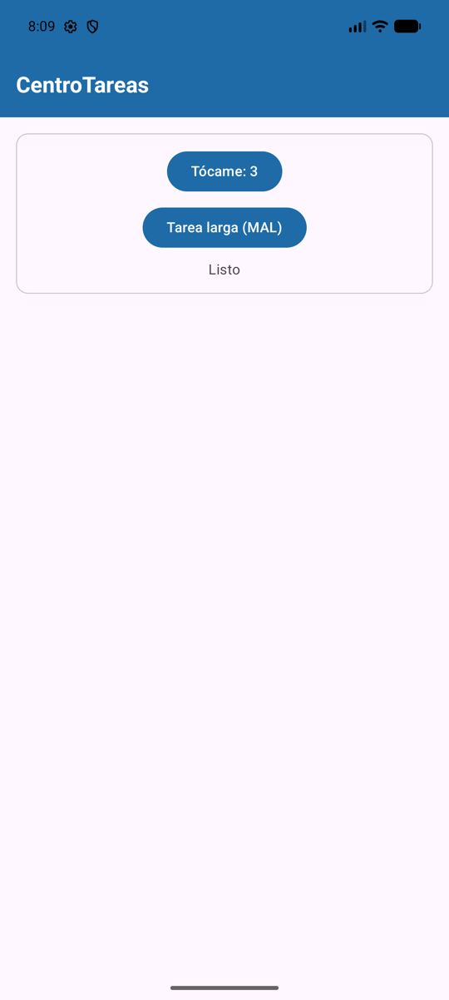
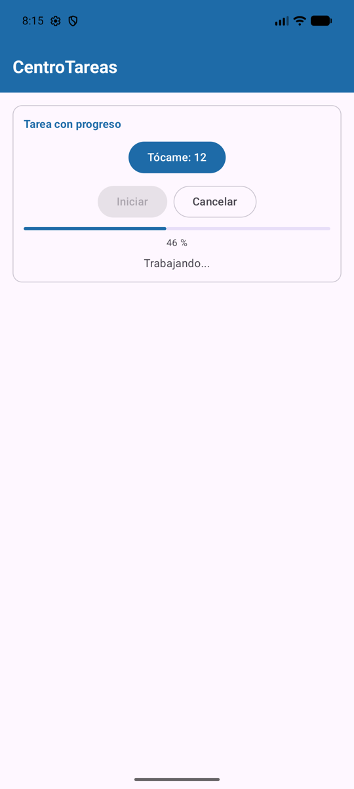
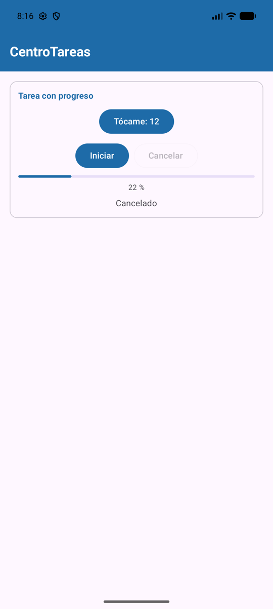
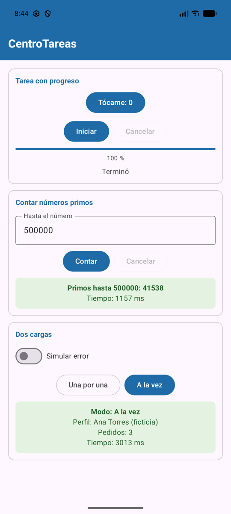
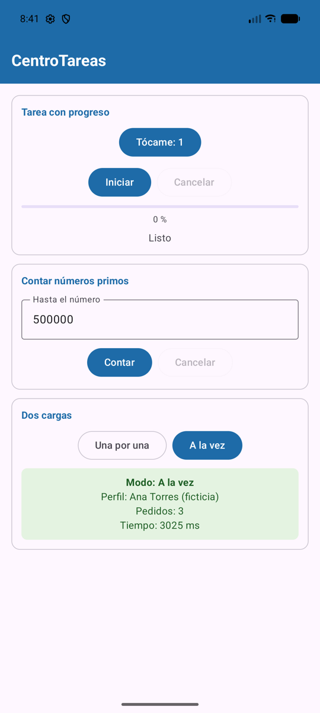
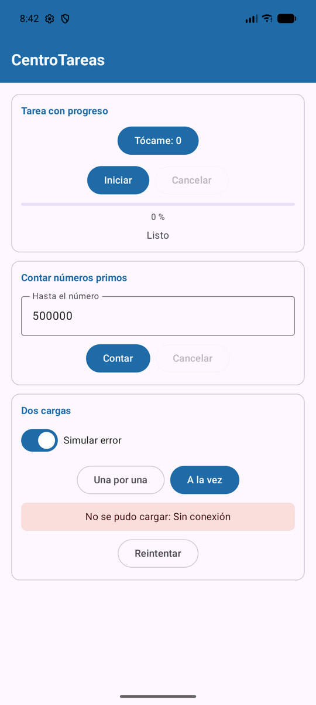

# CentroTareas

App Android que hace tres cosas que tardan sin congelar nunca la pantalla: una tarea con barra de progreso que se puede cancelar, un cálculo pesado (contar números primos) y dos cargas de datos simuladas que se comparan una por una contra a la vez. Todo el trabajo lento corre en corrutinas y el resultado vuelve al hilo principal. Usa solo datos ficticios.

- **Curso:** Programación en Móviles (Tecsup), Laboratorio 14: Hilos en Android
- **Alumno:** Reyes Saravia Jordan Arturo
- **Tecnología:** Kotlin + Jetpack Compose + Material 3 (sin XML), corrutinas y ViewModel
- **Patrón:** MVVM + Repository (interface)

## Funcionalidades

- Botón **Tócame** que cuenta los toques: es la prueba de vida de la pantalla.
- **Tarea con progreso**: barra de 0 a 100 % con `StateFlow<Float>`, botón **Iniciar** (deshabilitado mientras corre) y **Cancelar** con `Job`.
- **Contar números primos** hasta N en `Dispatchers.Default`, cancelable a mitad del cálculo con `ensureActive()`.
- **Dos cargas**: perfil (2 s) y pedidos (3 s), **una por una** (≈ 5 s) o **a la vez** con `async` (≈ 3 s).
- **Errores**: interruptor *Simular error*, recuadro rojo con el mensaje y botón **Reintentar**. La app nunca se cierra.

## Estructura de paquetes

```
com.reyes.centrotareas/
├── MainActivity.kt
├── model/
│   └── Estados.kt                    PrimosUi, CargaUi
├── data/
│   ├── TareasRepository.kt           interface
│   └── TareasRepositoryLocal.kt      cargas simuladas y contarPrimos
├── viewmodel/
│   ├── TareasViewModel.kt
│   └── TareasViewModelFactory.kt
└── ui/
    ├── PantallaTareas.kt             las tres tarjetas
    ├── Componentes.kt                Tarjeta y Recuadro
    └── theme/
```

## Arquitectura MVVM

```
View (PantallaTareas)
   |  eventos: botones              ^  collectAsState()
   v                                |
ViewModel (TareasViewModel)  --- StateFlow --->
   |  viewModelScope.launch { ... }
   v
TareasRepository (interface)  --->  TareasRepositoryLocal
                                    (cargas simuladas y contar primos)
```

| Capa | Conoce a | No debe |
|---|---|---|
| View (`ui/`) | Solo a su ViewModel | Lanzar corrutinas ni usar `Thread`; solo muestra el estado y avisa los eventos |
| ViewModel | Solo a la interface del Repository | Conocer Composables, recibir un `Context` ni bloquear el hilo principal |
| Repository | Nada de la UI | Exponer estados de pantalla; sus funciones `suspend` no bloquean el hilo que las llama |

En el código final no hay `GlobalScope`, `runBlocking` ni `Thread.sleep` (`git grep` sobre los `.kt` no encuentra nada).

## Observación del Paso 1

Al pulsar **Tarea larga (MAL)** la pantalla se queda congelada unos 4 segundos: el botón **Tócame** no suma y no responde a ningún toque. Cuando pasan los 4 segundos aparece directamente **Terminó** y recién ahí se procesan los toques que hice mientras estaba congelada.

El texto **Trabajando...** nunca se ve porque `Thread.sleep(4000)` corre en el **hilo principal**, que es el mismo que dibuja la pantalla. El mensaje sí cambia a *Trabajando...*, pero el hilo principal no queda libre para redibujar; cuando por fin se libera, el mensaje ya cambió a *Terminó*, así que solo se dibuja el último valor.

Si la espera fuera de 10 segundos, Android mostraría el diálogo **ANR** (*La aplicación no responde*), que aparece cuando el hilo principal no atiende un toque en unos 5 segundos, y ofrecería **Cerrar app** o **Esperar**.

## Capturas

| Paso 1: congelada | Pasos 3 y 4: con progreso | Paso 4: cancelada |
|---|---|---|
|  |  |  |

| Paso 5: primos | Paso 6: una por una | Paso 6: a la vez | Paso 7: error |
|---|---|---|---|
|  |  |  |  |

Logcat con el filtro `HILO`:

```
D HILO    : Antes: main
D HILO    : Dentro: DefaultDispatcher-worker-1
D HILO    : Despues: main
```

## Pruebas de aceptación

| Prueba | Resultado | OK |
|---|---|---|
| Tarea larga: tocar Tócame mientras trabaja | El contador sigue sumando | ✔ |
| Logcat con filtro HILO | `main` antes y después; `DefaultDispatcher-worker-1` dentro | ✔ |
| Iniciar la tarea con progreso | La barra avanza de 0 a 100 % (≈ 5,5 s en el emulador) | ✔ |
| Cancelar a mitad | La barra se detiene, dice Cancelado y se puede iniciar otra vez | ✔ |
| Pulsar Iniciar dos veces seguidas | No se lanzan dos tareas (botón deshabilitado) | ✔ |
| Primos hasta 1000 | 168 (y 25 con 100, 1229 con 10 000, 41 538 con 500 000) | ✔ |
| Primos con N grande (20 000 000) | La pantalla no se congela y Cancelar funciona | ✔ |
| Una por una | 5012 ms, Ana Torres (ficticia), 3 pedidos | ✔ |
| A la vez | 3025 ms, mismo resultado | ✔ |
| Error simulado + Reintentar | Recuadro rojo; al desactivar el interruptor y reintentar, éxito | ✔ |
| Rotar la pantalla durante la tarea | La tarea continúa y el progreso no se reinicia | ✔ |
| Revisar el código | `git grep` no encuentra `GlobalScope`, `runBlocking` ni `Thread.sleep` en los `.kt` | ✔ |

## Para pensar

**1. ¿Por qué no se veía Trabajando... en el Paso 1?**
Porque `Thread.sleep` bloqueaba el hilo principal, que es el único que dibuja la pantalla. El valor del mensaje cambió a *Trabajando...*, pero no hubo ningún cuadro dibujado mientras duró el `sleep`; cuando el hilo se liberó, el mensaje ya era *Terminó*.

**2. ¿Qué diferencia hay entre Thread.sleep y delay?**
`Thread.sleep` **bloquea** el hilo: nadie más puede usarlo mientras espera. `delay` es una función `suspend` que **suspende** solo la corrutina y libera el hilo para que haga otra cosa (dibujar, atender toques); cuando pasa el tiempo la corrutina continúa. Además, `delay` respeta la cancelación y `Thread.sleep` no.

**3. ¿Por qué Dispatchers.Default para los primos y Dispatchers.IO para la red?**
Contar primos usa mucho **procesador**: `Default` tiene tantos hilos como núcleos, que es lo ideal para cálculos. La red o el disco pasan casi todo el tiempo **esperando** una respuesta: `IO` tiene un grupo de hilos mucho más grande pensado para esas esperas, sin quitarle núcleos a los cálculos.

**4. ¿Qué pasaría con la corrutina si el usuario cierra la pantalla? ¿Qué papel cumple viewModelScope?**
`viewModelScope` está atado a la vida del ViewModel. Al rotar, el ViewModel sobrevive y la corrutina sigue (por eso el progreso no se reinicia). Si el usuario cierra la pantalla de verdad, el ViewModel se destruye (`onCleared`) y `viewModelScope` cancela automáticamente todas sus corrutinas, así no quedan tareas huérfanas gastando batería ni memoria.

**5. ¿Por qué async tarda 3 s y no 5 s? ¿Qué pasa si una de las dos cargas falla?**
Con `async` las dos cargas empiezan al mismo tiempo, así que el tiempo total es el de la más lenta: máximo(2 s, 3 s) ≈ 3 s. Una por una se suman: 2 s + 3 s ≈ 5 s. Si una falla dentro de `coroutineScope`, la excepción cancela a la otra carga y sale del bloque; el `catch` del ViewModel la atrapa y muestra *No se pudo cargar: Sin conexión* con el botón Reintentar.
